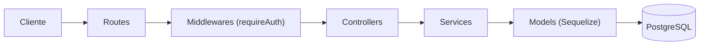

# Hybridge Blog API 🚀

API RESTful para la gestión de un blog (autores y publicaciones), con autenticación de usuarios mediante **JWT**. Proyecto de la materia **Desarrollo Back-End** (6to Cuatrimestre - Hybridge).

---

## 📖 Descripción General

La API permite:

- **Registrar usuarios** e **iniciar sesión** para obtener un token JWT.
- **Consultar** autores y publicaciones de forma pública.
- **Crear, editar y eliminar** autores y publicaciones únicamente con un token válido (rutas protegidas).

Los datos se almacenan en **PostgreSQL** a través del ORM **Sequelize**.

---

## 🛠️ Tecnologías Utilizadas

| Tecnología | Uso |
| :--- | :--- |
| [Node.js](https://nodejs.org/) | Entorno de ejecución de JavaScript |
| [Express](https://expressjs.com/) | Framework web y enrutamiento |
| [PostgreSQL](https://www.postgresql.org/) + [pg](https://www.npmjs.com/package/pg) | Base de datos relacional |
| [Sequelize](https://sequelize.org/) | ORM, modelos y migraciones |
| [Passport](https://www.passportjs.org/) (`passport-local`, `passport-jwt`) | Estrategias de autenticación |
| [jsonwebtoken](https://www.npmjs.com/package/jsonwebtoken) | Generación de tokens JWT |
| [bcryptjs](https://www.npmjs.com/package/bcryptjs) | Hash de contraseñas |
| [dotenv](https://www.npmjs.com/package/dotenv) | Variables de entorno |
| [nodemon](https://nodemon.io/) | Recarga automática en desarrollo |

---

## 🏛️ Arquitectura

El proyecto aplica **separación de responsabilidades** con una arquitectura por capas. Cada petición recorre:



| Capa | Responsabilidad | ¿Conoce `req`/`res`? |
| :--- | :--- | :---: |
| **Routes** | Asocia URL + método HTTP + middlewares → controlador | Sí |
| **Middlewares** | Lógica transversal: autenticación JWT y manejo de errores | Sí |
| **Controllers** | Lee la petición, llama al servicio y responde con el código HTTP adecuado | Sí |
| **Services** | Lógica de negocio y acceso a datos (Sequelize, bcrypt, JWT) | No |
| **Models** | Define la estructura de las tablas | No |

---

## 📂 Estructura del Proyecto

```text
hybridge-blog-api/
├── config/
│   └── config.json              # Conexión de Sequelize (usa DATABASE_URL)
├── migrations/                  # Migraciones de Authors, Posts y Users
├── models/                      # Modelos de Sequelize (index, author, post, user)
├── src/
│   ├── config/
│   │   ├── env.js               # Carga las variables de entorno (PORT, JWT_SECRET)
│   │   └── passport.js          # Estrategias Local (login) y JWT (protección)
│   ├── controllers/
│   │   ├── auth.controller.js   # signup, login, profile
│   │   ├── authors.controller.js
│   │   └── posts.controller.js
│   ├── services/
│   │   ├── auth.service.js      # Hash de contraseñas y generación de tokens
│   │   ├── authors.service.js   # Consultas a la tabla Authors
│   │   └── posts.service.js     # Consultas a la tabla Posts
│   ├── middlewares/
│   │   ├── auth.middleware.js   # requireAuth (protege rutas con JWT)
│   │   └── error.middleware.js  # 404 de rutas inexistentes y errores 500
│   ├── routes/
│   │   ├── index.js             # Agrupa todas las rutas bajo /api
│   │   ├── auth.routes.js
│   │   ├── authors.routes.js
│   │   └── posts.routes.js
│   └── app.js                   # Configura Express (middlewares y rutas)
├── server.js                    # Punto de entrada: inicia el servidor
├── .env.example                 # Plantilla de variables de entorno
├── .sequelizerc                 # Configuración de sequelize-cli
└── package.json                 # Dependencias y scripts
```

> [!NOTE]
> `config/`, `models/` y `migrations/` permanecen en la raíz porque es donde `sequelize-cli` los busca por defecto.

### ¿Cómo agregar un nuevo recurso? (ej. comentarios)

1. Crear el modelo y la migración con `npx sequelize-cli model:generate`.
2. Crear `src/services/comments.service.js` con las consultas.
3. Crear `src/controllers/comments.controller.js` con las respuestas HTTP.
4. Crear `src/routes/comments.routes.js` y registrarlo en `src/routes/index.js`.

---

## ⚙️ Instalación Rápida

```bash
git clone https://github.com/TheRevised/hybridge-blog-api.git
cd hybridge-blog-api
npm install
cp .env.example .env        # En PowerShell: Copy-Item .env.example .env
npx sequelize-cli db:migrate
npm run dev
```

**Variables de entorno (`.env`):**

| Variable | Descripción |
| :--- | :--- |
| `PORT` | Puerto del servidor (por defecto `3000`) |
| `DATABASE_URL` | Cadena de conexión a PostgreSQL |
| `JWT_SECRET` | Clave secreta para firmar los tokens JWT |

---

## 📡 Documentación de la API

**URL base:** `http://localhost:3000`

🔒 = requiere el header `Authorization: Bearer <token>`

### Autenticación

| Método | Ruta | Descripción | Body |
| :--- | :--- | :--- | :--- |
| `POST` | `/api/signup` | Registrar un usuario | `{ "name", "email", "password" }` |
| `POST` | `/api/login` | Iniciar sesión y obtener token | `{ "email", "password" }` |
| `GET` | `/api/profile` 🔒 | Datos del usuario autenticado | — |

**Ejemplo - Login:**

```json
// POST /api/login
{ "email": "abel@test.com", "password": "123456" }

// Respuesta 200 OK
{ "token": "eyJhbGciOiJIUzI1NiIs...", "token_type": "Bearer" }
```

> El token expira en **1 hora**.

### Autores

| Método | Ruta | Descripción | Body |
| :--- | :--- | :--- | :--- |
| `GET` | `/api/authors` | Listar autores | — |
| `GET` | `/api/authors/:id` | Obtener un autor | — |
| `POST` | `/api/authors` 🔒 | Crear autor | `{ "name" }` |
| `PATCH` | `/api/authors/:id` 🔒 | Editar autor | `{ "name" }` |
| `DELETE` | `/api/authors/:id` 🔒 | Eliminar autor | — |

### Publicaciones

| Método | Ruta | Descripción | Body |
| :--- | :--- | :--- | :--- |
| `GET` | `/api/posts` | Listar publicaciones | — |
| `GET` | `/api/posts/:id` | Obtener una publicación | — |
| `POST` | `/api/posts` 🔒 | Crear publicación | `{ "title", "content", "authorId" }` |
| `PATCH` | `/api/posts/:id` 🔒 | Editar publicación | `{ "title", "content" }` |
| `DELETE` | `/api/posts/:id` 🔒 | Eliminar publicación | — |

### Códigos de respuesta

| Código | Significado |
| :--- | :--- |
| `200 OK` | Petición exitosa |
| `201 Created` | Recurso creado |
| `400 Bad Request` | Datos inválidos (ej. email duplicado en registro) |
| `401 Unauthorized` | Token ausente, inválido o expirado / credenciales incorrectas |
| `404 Not Found` | El autor, la publicación o la ruta no existe |
| `500 Internal Server Error` | Error inesperado del servidor (manejado por `error.middleware.js`) |

---

## 📄 Licencia

Proyecto académico distribuido bajo la licencia **ISC**.